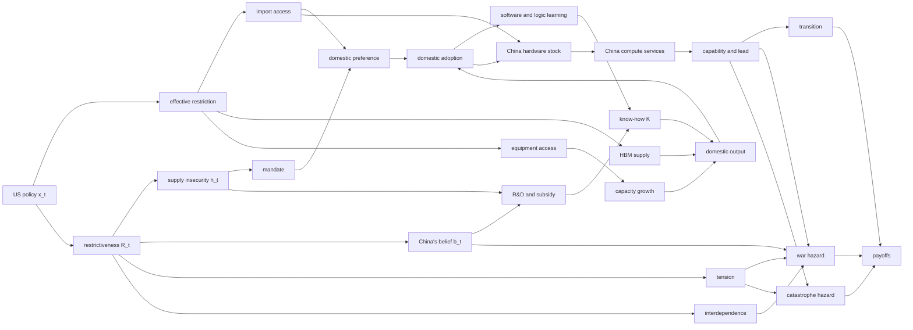

# Model specification

This is the specification of the simulator in `src/ai_controls` and its browser port, `web/model.js`. Parameter values, ranges and sources are in `configs/baseline.yaml`.

## Game tree

The computation is a stochastic dynamic simulation that samples trajectories. It does not enumerate leaves.

```mermaid
flowchart TD
    U[US chooses controls vector x_t] --> C[China observes and responds: mandate, R&D and subsidy, retaliation, evasion]
    C --> F[Domestic output and the Chinese hardware market]
    F --> E[Stocks, power, compute services, capability]
    E --> B{Frontier crosses the transition threshold?}
    B -->|Not yet| R[Continue: improvement, diffusion, adaptation]
    B -->|Yes| D{Lead at arrival; distributed or near-simultaneous?}
    D -->|Clear leader| K{Capture share k = d (1 - e^-lead/c)(1 - w O), persistence H}
    D -->|Distributed or near-simultaneous| O[Outcome regime]
    K --> O
    R --> O
    O --> P[Payoff vector: output, trade, openness, lead capture, institutions, war, catastrophe, security, liberty, integration]
    P --> U2[Next year]
    U2 --> U
```

War and catastrophe are annual hazards on every branch. They are not terminal choices.

## Causal graph



## Time and sequence

Steps are annual, 2026–2050. A terminal value multiplies the 2050 flows by \(\sum_{k=1}^{N} (\rho/(1+r))^k\), with N = `terminal_years` and persistence ρ = `terminal_persist`.

Within each year:

1. **US policy.** The 2026 policy is the inherited status quo under every policy. Fixed policies apply their vector from 2027. The adaptive policy moves the chip and cloud dimensions by `gain × (target_lag − observed lag)`, using last year's lag plus observation noise. After a war, every dimension is 1.
2. **China responds** (an assumed rule):
   - R&D and subsidy effort \(y^{rd} = \max(1 + \rho_h(h-0.5) + \rho_b(b-b_0), 0)\);
   - mandate \(m = \text{clip}(m_0 + m_h(h-0.5))\);
   - retaliation \(y^{ret} = \text{clip}(\text{ret}_R R + \text{ret}_{\Delta R}\max(R-R_{t-1},0))\);
   - evasion \(y^{fa} = \text{clip}(\text{fa}_R R)\).

   Stance multipliers scale the first two and the third, for the strategic game.
3. **Leakage.** For each restriction, \(x^{\text{eff}}_k = x_k[1 - \ell_k (1-x_{enf})(\tfrac12 + \tfrac12 y^{fa})]\).
4. **Western supply.** Output \(W_t = w_0 e^{\sum g_w}\) has a growth rate that decays from `g_w0` to `g_w_inf`. A share `perf_share` of that growth is per-chip performance. Fab loss after a denial or capture war scales with US dependence on Taiwan and recovers over `fab_recovery` years.
5. **Domestic output.** All quantities are converted to chip equivalents first:
   - logic: \(L\cdot y(K_{logic})\);
   - domestic HBM: \(H\cdot y(K_{hbm})\);
   - imported HBM: the remaining gap times \((1-x^{\text{eff}}_{HBM})\);
   - stockpile draw: any gap still left;
   - packaging capacity: \(P_k\).

   Chips = min(logic, HBM available, packaging) × final yield, applied once. Output in capacity units is \(Q = \text{chips}\cdot e^{-\gamma(1-K_{logic})}\cdot\text{perf}_t\).
6. **Chinese market.** Demand is a share of Western output, scaled by China's belief. The domestic preference is \(s=\sigma(a_0 + b_m m(1-\varepsilon\,\text{acc}) + e_h h - d_q \ln(q^{imp}/q^{dom}))\), where acc falls at once when controls tighten and recovers gradually when they ease. Then:
   - Desired imports are scaled by access.
   - A share `spill_dom` of blocked import demand turns to domestic chips.
   - Domestic additions are min(domestic demand, Q).
   - A domestic shortfall is partly back-filled by accessible imports.
   - Unmet need accumulates in a backlog that rented cloud can partly serve.
7. **Power and services.** The usable fraction of each stock is min(1, power available / power needed).
   - Power is measured in what a 2026 Western chip could run. Need falls with Western performance per watt, and a Chinese chip needs \(e^{\gamma_w(1-K_{logic})}\) times as much (`ppw_gamma`, anchored to Huawei's CloudMatrix 384).
   - US power in 2026 is `pow_slack_us0` times US need. China's is `pow_cn_us0` times the US's, a physical ratio, so a higher `ppw_gamma` leaves China less spare power instead of cancelling out.
   - Each year each country builds toward its 2026 ratio of power to expected need, adding at most `g_e_us` or `g_e_cn` log points and never removing power. Power binds only when need outgrows the build rate for long enough to use up the spare capacity.
   - US services lose the share of rented capacity that would otherwise serve US users. China's training compute counts rented compute at a discount. Rentals never enter China's stock.
8. **Capability.** \(\ln A^{US}=\alpha \ln(T^{US}/T^{US}_0)+G^{US}\). China's capability is \(\max(\min(\alpha\ln(T^{CN}/T^{US}_0)+G^{CN},\ \ln A^{US}-\phi),\ \alpha\ln(T^{CN}/T^{US}_0)+G^{US}-\gamma)\).
   - \(G^{CN}_{2026}\) reproduces the observed lag `lag0`.
   - The intrinsic gap \(\gamma\) is a world type, `intrinsic_gap` plus a normal shock with spread `intrinsic_sd`, held fixed across policies. Where Chinese labs' own methods are better than US labs', China leads once its compute is close enough.
   - Diffusion pulls the algorithmic gap toward the level at which the 2026 gap is a steady state at the 2026 compute ratio.
   - China's own algorithmic progress scales with its relative compute to the power `theta_exp`.
   - Chinese research spills into the frontier in proportion to China's relative compute and openness.
   - The lead in years is \((\ln A^{US}-\ln A^{CN})/(\alpha g_W + g_{alg})\).
9. **Openness.** US-origin open models trail the US frontier by `open_gap_us` plus a world-type shock. Chinese releases trail the Chinese frontier by `open_lag_cn`, widening with tension and with China's belief. Open-model pressure is \(O = 1-(1-o_{US})(1-o_{CN})\), with \(o=e^{-\text{gap}/s}\).
10. **Transition.** It arrives when the frontier reaches \(\theta\), where \(\ln\theta \sim N(\ln\theta_{med}, \sigma_\theta^2)\) with probability 1 − `p_no_threshold`, and otherwise there is no threshold. At arrival:
    - leader, lead ℓ;
    - distributed with probability \(e^{-\max(A^{front}-A^{open},0)/g_d}\);
    - near-simultaneous if ℓ < `sim_window`;
    - capture \(k = d(1-e^{-\ell/c})(1-\omega O)\), zero if distributed.

    The advantage held is \(a_t = k\,2^{-(t-t^*)/H}\). Decisiveness d comes from a Kumaraswamy mixture: high regime with probability `p_high_dec`, mean 0.77; low regime mean 0.19. H is lognormal with P(H ≥ 10) = `p_persist10` and is correlated with the regime draw.
11. **Catastrophe hazard.** It is summed over the two developers: \(h^{cat} = c_0(1+\kappa_r e^{-|\ell|/\tau_s}(\tfrac12+\tfrac12T))(1+o_r O)\,[\text{prox}_{US}\,s_{US} + m_{CN}\,\text{prox}_{CN}\,s_{CN}]\).
    - Each developer's proximity rises as its own capability nears the threshold and decays with half-life `cat_window` after it crosses, so a trailing developer adds risk while it closes in.
    - The leader's factor is \(s = 1-\lambda_s u_s(1-e^{-|\ell|/\tau_s})\), where \(u_s\) = `slack_used` is the share of the slack actually spent on safety. The follower's factor is 1.
    - \(m_{CN}\) = `cat_mult_cn` is set explicitly in each worldview: 1 in the continuous one, 1.5 in the decisive one, sampled from 0.5 to 3 in the agnostic one. All of these are illustrative.
    - With the Chinese developer far from the threshold, \(u_s=1\) and the US ahead, this reduces to a single-frontier hazard.
    - `cat_decomposition` switches each channel off on the same paths (lead slack, race, nationality, openness). The remainder, "exposure", is the change in how close each developer gets to the threshold, plus interactions. The loss enters payoffs as an exact expectation \(1-\prod(1-h^{cat})\), because a catastrophe has no feedback on the state. Simulated events are kept for outcome probabilities.
12. **War hazard.** \(h^{war}=\sigma(\theta_0 + \theta_T(T-T_0) + \theta_S\, b\,\text{dep}^{TW} x^{\text{eff}}_{chips} - \theta_D\tanh(\max(\ell,0)/\tau) - \theta_I(I-I_0) + \epsilon_{world} + \epsilon_t)\). A war is a denial, capture or limited conflict, with different fab losses and costs. A war may escalate to a permanent output loss.
13. **State update.**
    - Stocks depreciate and add deliveries.
    - Capacity grows toward a demand-based target, at a rate limited by equipment access and subsidy.
    - Learning increments come from new experience only.
    - Insecurity rises fast and fades slowly.
    - Belief moves with restrictiveness (signalling) and proximity.
    - Tension and interdependence adjust toward targets set by R and retaliation.

## Know-how

\(K_{t+1} = (1-\delta)K_t + r\,\log_2(1+y^{rd}_{eff})\,\tau\,(1-K_t) + \lambda[\ln(1+E_{t+1}/\bar E)-\ln(1+E_t/\bar E)] + \kappa (1-x^{\text{eff}})(1-K_t)\), bounded to [0, 1].

- \(y^{rd}_{eff}\) adds revenue-funded R&D from domestic vendors' market share.
- τ is the equipment-access dependence of R&D returns.
- New experience is defined per index:
  - logic: chips sold;
  - HBM: stacks used;
  - equipment: domestic tools installed in new capacity, which rises when foreign tools are restricted;
  - software: operating time on domestic chips, weighted by how much leading buyers use them.

## State variables

| Symbol | Meaning | Units |
|---|---|---|
| C_US, C_CN (= C_dom + C_imp) | installed AI hardware capacity | CU (1 CU = 1% of the 2026 US stock, standardised FLOP/s) |
| W, Q_dom, imports, dom_add | annual additions | CU per year |
| S_US, S_CN | usable compute services | CU-years per year |
| K_logic, K_hbm, K_sme, K_soft | know-how relative to the frontier | index 0–1 |
| L, H, P_k | logic, HBM and packaging capacity | chip equivalents per year |
| ln A_US, ln A_CN | capability | nats above the 2026 US frontier |
| O | open-model competitive pressure | index 0–1 |
| T, I | tension, interdependence | index 0–1 |
| h, b | supply insecurity, China's belief that AI is decisive | index, probability |
| a | advantage held by a leader | share of contestable returns |

## Payoffs

The components are in trillions of 2026 dollars, discounted, and differenced across policies on the same world:

| Component | Content |
|---|---|
| ai_* | GDP × (pre-transition uplift + post-transition growth), plus size-weighted idea spillovers |
| trade_* | export profit × (1 − scarcity) net of competing Chinese exports, minus retaliation, decoupling and subsidy costs |
| open_*, rent_us | open-access gains, minus markups and deadweight loss; markups received by US providers are a separate component |
| lead_* | the leader captures a share a of others' contestable post-transition output (with deadweight loss); the losers lose it |
| inst_* | an institutionally adverse durable order costs every economy `adverse_cost` × a of its output |
| war_*, cat_* | output losses |
| sec_*, liberty, trust, sov_cn | index-years: exposure to a rival's durable advantage and pre-transition capability edge, openness and pluralism, integration minus tension, China's sovereign capacity |

The weight sets are `us_interest`, `global` and `pluralist`. `lead_extra_*` would add value per advantage-year beyond the modelled channels. It is zero by default, so there is no hidden jackpot.

## Calibration

Two primitives are solved under the reference policy (Maintain) on the event-free path and then held fixed for every policy:

- the threshold median, from P(transformative AI by 2035);
- the war intercept, from cumulative P(first war by 2040), using \(1-\prod(1-h_t)\).

Emergent quantities are reported beside their targets and never imposed as effects:

- the 2027 compute ratio;
- the 2026 capability lag;
- domestic share;
- extra adoption from keeping chip controls;
- domestic output lost to SME/HBM controls with chip controls held fixed;
- marginal war risk;
- the long-run compute ratio.

## Outcome regimes

The regimes are:

- no sharp transition;
- distributed frontier;
- near-simultaneous;
- a clear leader with durable capture (k ≥ 0.25 and H ≥ 10 years), a lead that dissipates (k ≥ 0.08), or little capture (no monopoly).

War, catastrophe and adverse institutions overlap all of them.

## Invariants (tested)

The tests are in `tests/`. They check that:

- probabilities sum to one and hazards stay in [0, 1];
- there are no negative stocks;
- domestic and imported additions never exceed demand;
- the stock identity holds without rentals;
- a rental adds services for one year only;
- power cannot create compute without chips;
- tighter chip controls never directly raise imports;
- easier inputs never lower feasible output;
- learning is zero without new experience;
- controls can raise or lower Chinese capability, and raise or lower war risk;
- arrival without lock-in is possible, and China can arrive first;
- calibration is solved once and shared across policies;
- results are reproducible, with keyed draws;
- the decomposition sums to the total;
- there is no default jackpot;
- the JavaScript and Python engines agree.
